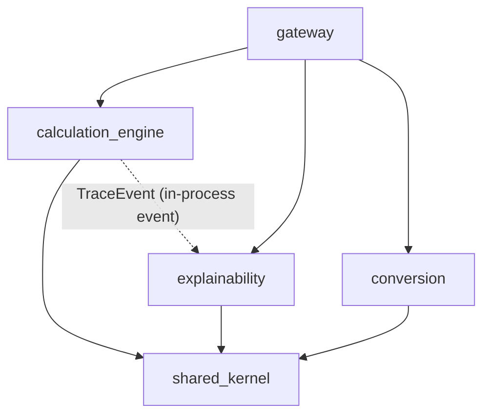
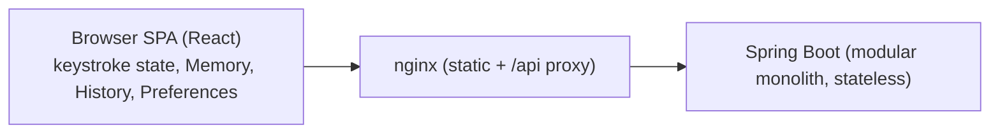

# Architecture Spine — CalcHub

## Design Paradigm

**Modular monolith, stateless server, stateful client.** One Spring Boot deployable whose Spring Modulith modules (top-level packages under `com.bmad.calculator`) are verified by test. The server computes and holds no user data. The browser holds all user state (keystroke state, Memory Register, History, Preferences) and calls the server for every calculation.

| Layer | Location |
| --- | --- |
| Server module (Modulith) | `backend/src/main/java/com/bmad/calculator/<module>/` |
| Module published API | the module's root package (everything else is `internal`) |
| Client feature | `frontend/src/features/<feature>/` |
| Client shared code | `frontend/src/shared/` |
| API contract | `api/openapi.yaml` |

## Invariants & Rules



Arrows are the only allowed compile-time dependencies. The dotted edge is an event, not a dependency: `explainability` depends on the event type in `shared-kernel`, never on `calculation-engine`.

### AD-1 — Server is stateless; the browser owns user state [ADOPTED]

- **Binds:** FR-14, FR-15, FR-16..FR-20, FR-27, FR-28, NFR-8
- **Prevents:** a second persistence path (server tables vs. browser storage) for Memory, History, Preferences.
- **Rule:** The backend has no database and no session or identity concept in Phase I. Memory Register, History, and Preferences are persisted only in the browser, behind the `StoragePort` in `frontend/src/shared/storage/` (IndexedDB for History; localStorage for Memory and Preferences). Phase II identity swaps the adapter behind `StoragePort`; no feature code touches `indexedDB` or `localStorage` directly.

### AD-2 — The browser never does arithmetic

- **Binds:** FR-1..FR-13, FR-21..FR-26
- **Prevents:** floating-point drift and duplicated math rules between client and server.
- **Rule:** All evaluation, percent, scientific, base-conversion, and unit-conversion math runs in the backend. The browser only builds expression strings and renders results. Basic mode keeps its keystroke state machine in the browser (`features/calculator`) and calls the evaluation endpoint with a two-operand expression for each chained operation, which yields left-to-right chaining (FR-5). Numbers cross the wire as JSON **strings**, never JSON numbers.

### AD-3 — One evaluation pipeline, hand-written and safe

- **Binds:** FR-9..FR-13, FR-29, NFR-3, NFR-5
- **Prevents:** a second evaluator, or a "trace" that diverges from the real evaluation.
- **Rule:** `calculation-engine` implements exactly one pipeline: lexer → parser (Pratt/recursive descent, producing an AST) → planner (fixes evaluation order) → evaluator over `BigDecimal` (`MathContext.DECIMAL128` internally; display rounding to the requested Precision happens last). No `eval`, no script engines, no parser generators that execute code. Percent (`%`) semantics are defined only in the engine's grammar: standalone `x%` is `x/100`; as the right operand of `+` or `-`, it is that percentage of the left operand. Limits enforced in the lexer/parser: max 256 characters, max nesting depth 32.

### AD-4 — Trace is produced by the same pipeline, via events

- **Binds:** FR-29..FR-32, NFR-2
- **Prevents:** simulated trace steps; `explainability` coupling to engine internals.
- **Rule:** Each pipeline stage in `calculation-engine` publishes `TraceEvent`s (record type defined in `shared-kernel`; fields: `evaluationId`, `stage`, `detail`, `value`, `nanoTime`) through Spring's `ApplicationEventPublisher`, and only when the evaluation was started with tracing enabled. The engine publishes, as events, exactly what it does; it never builds a Trace. `explainability` listens with a **synchronous** `@EventListener` (same thread, same request), buffers events by `evaluationId`, and assembles the Trace (Phase Labels, step count, duration). Phase Label mapping lives only in `explainability`: tokenize→Analysis, parse→Planning, plan→Solutioning, evaluate→Implementation.

### AD-5 — `gateway` orchestrates; engine and explainability never call each other

- **Binds:** FR-29, FR-33
- **Prevents:** a cycle between engine and explainability, or business logic in controllers.
- **Rule:** The `gateway` module owns all REST controllers and the request/response mapping. For an evaluation it generates the `evaluationId`, calls `explainability.begin(id)` if `trace=true`, calls `calculation-engine`'s published `Evaluator.evaluate(...)`, then calls `explainability.collect(id)` and returns result and trace in **one** response. Buffers are removed on `collect` and on any exception (try/finally). No SSE or streaming in Phase I.

### AD-6 — Contract-first API; one error shape

- **Binds:** FR-6, FR-10, FR-21, FR-29, all endpoints
- **Prevents:** hand-written client types drifting from server behavior; inconsistent errors.
- **Rule:** `api/openapi.yaml` (OpenAPI 3.1) is the source of truth. Server interfaces and DTOs are generated from it by Gradle; TypeScript types are generated from it by `npm run gen:api`. Hand-edits to generated code are forbidden, and CI fails if regenerated output differs from the committed contract. Every failure returns RFC 9457 `application/problem+json` with a stable string `code` (e.g. `DIVISION_BY_ZERO`, `SYNTAX_ERROR`, `DOMAIN_ERROR`, `LIMIT_EXCEEDED`) and, for syntax errors, a 1-based integer `position`. HTTP 422 for calculation errors, 400 for malformed requests.

### AD-7 — Spring Modulith boundaries are enforced by test

- **Binds:** all backend modules, NFR-7
- **Prevents:** cross-module repository, entity, or internal-class access.
- **Rule:** A `ModularityTests` test calls `ApplicationModules.of(...).verify()` and fails the build on violation. Only a module's root package is public; implementation lives in `internal` sub-packages. `shared-kernel` is declared an open module and holds only value types (`TraceEvent`, `AngleUnit`, `Mode`, error codes), no behavior. ArchUnit rules additionally forbid `java.lang.reflect`-based evaluation and `ScriptEngine` imports.

### AD-8 — Unit-conversion factors are data

- **Binds:** FR-21..FR-23
- **Prevents:** conversion logic with hard-coded factors.
- **Rule:** Units live in `backend/src/main/resources/units/*.yaml` (one file per Unit Category), with factors as exact decimal strings. `conversion` does `BigDecimal` math using only that data; temperature uses an explicit offset entry. The frontend gets the unit list from `GET /api/v1/units` and has no unit knowledge of its own.

### AD-9 — Client feature slices mirror modules; React Query for server, small store for UI

- **Binds:** FR-7, FR-33, FR-34, NFR-4
- **Prevents:** server state copied into UI stores; features reaching into each other.
- **Rule:** Features: `calculator`, `scientific`, `programmer`, `history`, `memory`, `conversion`, `preferences`, `trace`. A feature exposes only its `index.ts`; features talk through `shared/` or the UI store, never by importing another feature's internals. Server calls are React Query hooks (evaluation is a mutation). UI state (current entry, mode, panel open, Angle Unit) is a Zustand store. Preferences feed request parameters (`precision`, `angleUnit`) at the call site, never hidden in the server.

### AD-10 — Programmer mode is an engine mode, unsigned in Phase I

- **Binds:** FR-24..FR-26
- **Prevents:** a second arithmetic path for integers.
- **Rule:** Programmer mode uses the same evaluation endpoint with `mode=PROGRAMMER`, `base`, and `wordSize`; the engine handles bitwise operators on `BigInteger` masked to the Word Size. Phase I values are non-negative and unsigned. Signed display and overflow semantics are deferred to Phase II.

## Consistency Conventions

| Concern | Convention |
| --- | --- |
| Naming | Java packages `com.bmad.calculator.<module>[.internal]`; modules lower-kebab in docs, single lowercase word in packages (`calculationengine`); REST paths `/api/v1/<plural-noun>`; TS files `kebab-case.ts`, components `PascalCase.tsx` |
| Data & formats | Decimals and integers as strings in JSON; timestamps ISO-8601 UTC; ids UUIDv4 (History Entry ids generated in the browser); errors per AD-6 |
| State & cross-cutting | No mutable server state; no globals except Spring beans; logging via SLF4J, JSON structured logs, expression text logged only at DEBUG; config via `application.yaml` + env vars; `evaluationId` in the MDC for the request |
| Testing | Backend: JUnit 5, `ModularityTests`, ArchUnit; Frontend: Vitest + React Testing Library; E2E: Playwright against Docker Compose; coverage gate 80% on `calculation-engine` and `explainability` (JaCoCo) |
| Accessibility | Every interactive element is a native control or has a role and accessible name; focus order follows visual order; no keyboard trap in the Trace Panel |

## Stack

| Name | Version |
| --- | --- |
| Java | 21 (LTS) |
| Gradle (Kotlin DSL, single build, wrapper committed) | 9.6.1 |
| Spring Boot | 3.5.x (latest patch, 3.5.16 at authoring) |
| Spring Modulith | 1.4.x (1.4.13, built on Boot 3.5.16) |
| big-math (`ch.obermuhlner:big-math`) | 2.3.2 |
| OpenAPI | 3.1 |
| Node.js | 22 LTS |
| React | 18.3.x |
| TypeScript | 5.x (latest 5) |
| Vite | 8.0.x |
| Tailwind CSS | 4.2.x |
| @tanstack/react-query | 5.x |
| Zustand | 5.x |
| Vitest | 4.1.x |
| Playwright | latest at scaffold, then pinned |
| Docker Compose | v2 |

## Structural Seed



Deployment: `docker compose up` runs two containers, `web` (nginx serving the Vite build and proxying `/api`) and `api` (Spring Boot). No database. Single environment locally; CI runs on GitHub Actions: backend build and tests, frontend lint and tests, regenerate-and-diff of API types, Playwright E2E against Compose. Health: `/actuator/health`, metrics: `/actuator/metrics`.

```text
calchub/
  api/openapi.yaml          # contract, source of truth
  backend/                  # Gradle project
    src/main/java/com/bmad/calculator/
      gateway/              # controllers, orchestration
      calculationengine/    # lexer, parser, planner, evaluator, modes
      explainability/       # trace assembly, phase labels
      conversion/           # unit conversion
      sharedkernel/         # TraceEvent, enums, error codes
    src/main/resources/units/
  frontend/
    src/features/           # calculator, scientific, programmer, history, memory, conversion, preferences, trace
    src/shared/             # api client (generated), storage port, ui store
  docker-compose.yml
  .github/workflows/
```

## Capability → Architecture Map

| Capability / Area | Lives in | Governed by |
| --- | --- | --- |
| Basic calculator (FR-1..FR-8) | `features/calculator` + `calculationengine` | AD-2, AD-3 |
| Expression mode (FR-9, FR-10) | `calculationengine` | AD-3, AD-6 |
| Scientific (FR-11..FR-13) | `calculationengine`, `features/scientific` | AD-2, AD-3 |
| Memory (FR-14, FR-15) | `features/memory` | AD-1, AD-2 |
| History (FR-16..FR-20) | `features/history` | AD-1 |
| Unit converter (FR-21..FR-23) | `conversion`, `features/conversion` | AD-8 |
| Programmer mode (FR-24..FR-26) | `calculationengine`, `features/programmer` | AD-10 |
| Preferences (FR-27, FR-28) | `features/preferences` | AD-1, AD-9 |
| Trace Visualizer (FR-29..FR-34) | `explainability`, `gateway`, `features/trace` | AD-4, AD-5 |
| Security (NFR-5) | `calculationengine` | AD-3 |
| Observability (NFR-6) | Spring Actuator, logging convention | Conventions |
| Quality gates (NFR-7) | JaCoCo, `ModularityTests` | AD-7 |

## Deferred

- **Phase II identity and per-user storage:** swap the `StoragePort` adapter and add an `identity` module and database; reason: no identity in Phase I.
- **Signed display and overflow in Programmer mode:** reason: deferred by PRD to Phase II.
- **Rate limiting and abuse protection:** reason: demo-scale, stateless, no accounts.
- **Spring Boot 4.x upgrade:** Boot 3.5 is past free open-source support (ended 2026-06-30) but is the stable pair with Modulith 1.4.x and Java 21 for this tutorial. Revisit after Phase I; the upgrade also moves Spring Modulith to 2.x and brings Spring Framework 7 and Jackson 3.
- **SSE or streamed trace:** reason: REST response meets FR-29; revisit only if a trace must stream mid-evaluation.
- **Client storage limits for History:** pruning policy; reason: wait for real usage.
- **Playwright and TypeScript exact pins:** pin at scaffold.
