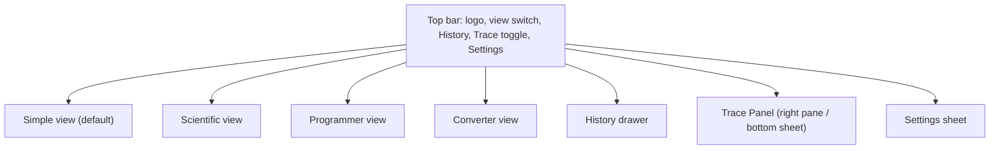

# CalcHub Experience

Visual identity (colors, type, shapes, component looks) lives in `DESIGN.md`; tokens are referenced here as `{path.to.token}`. If a mock or an import disagrees with these two files, the files win.

## Foundation

- **Form factor:** responsive web app, desktop first. Works on tablet and phone widths (Trace Panel collapses, see Responsive).
- **UI system:** none beyond Tailwind CSS. DESIGN.md tokens map to Tailwind theme variables, and the three theme modes (Light, Dark, System) switch them.
- **Language:** English only in Phase I. All user-facing text is kept in one strings module (`shared/strings`) so translation can be added later. `[ASSUMPTION: no translation or right-to-left support in Phase I; "languages" was read as visual and tone language, not human languages.]`
- **Stakes:** solo tutorial project, so the depth here is deliberately light.

## Information Architecture

One workspace, not many pages. The top bar switches between views; side surfaces open over or beside the calculator.

| Surface | Purpose | PRD |
| --- | --- | --- |
| **Simple view** | Everyday arithmetic: digits, four operations, %, ±, memory row, C/CE/backspace, `=`. The display also accepts a typed expression with parentheses. | FR-1..FR-10, FR-14 |
| **Scientific view** | Everything in Simple plus functions, constants, parentheses, powers, factorial, the DEG/RAD/GRAD toggle. Function keys sit in tabs `main · func` on narrow screens. | FR-9..FR-13 |
| **Programmer view** | Base selector (BIN/OCT/DEC/HEX), word size, hex keys A-F, bitwise keys. Shows the value in all four bases. | FR-24..FR-26 |
| **Converter view** | Category tabs, two linked fields, unit pickers. | FR-21..FR-23 |
| **History drawer** | Newest-first list, search box, page controls, per-row delete, clear all. | FR-16..FR-20 |
| **Trace Panel** | Pipeline trace for the last evaluation, grouped by phase. Available from every calculation view. | FR-29..FR-34 |
| **Settings sheet** | Theme, Precision, default Angle Unit, number grouping. | FR-27, FR-28 |

Closure: every PRD feature has a surface above, and each is reached in one step from the top bar. `[ASSUMPTION: the Trace Panel is available in Simple and Scientific views (and Programmer), not Converter.]`

## Voice and Tone

Friendly, short, plain. Say what happened and what to do next. No jargon, no blame, no exclamation marks.

| Situation | Text |
| --- | --- |
| Divide by zero | "Can't divide by zero." |
| Syntax error | "Check the expression: unexpected `*` at position 5." (position is 1-based) |
| Domain error | "√ needs a number that is 0 or more." |
| Too long / too complex | "That expression is too long or too deeply nested. Try splitting it." |
| Server unreachable | "Can't reach the calculator service. Check your connection and try again." |
| Empty history | "No calculations yet. Results you evaluate will show up here." |
| Clear all history (confirm) | "Delete all history? This can't be undone." Buttons: "Delete all", "Keep" |
| Trace analogy notice | "The phase names are an analogy. BMAD is a development-time workflow, not part of how CalcHub runs." |

## Component Patterns

- **Keypad.** Keys are real buttons. One press, one action; no long-press or double-press behavior in Phase I. Operators highlight while pending, and pressing another operator replaces it.
- **Display.** The upper line shows the expression, the lower line shows the result or current entry. After `=` the result stays and the expression remains above it. Typing a digit after `=` starts a new calculation; pressing an operator continues from the result.
- **Simple-view entry rule.** Keypad presses chain left to right as entered (FR-5). Typing a parenthesized expression from the keyboard switches that entry to expression evaluation on `=`. `[NOTE FOR UX: the user decided one display accepts both. Revisit in a build story if the two rules surprise anyone.]`
- **View switch.** Switching view keeps the current expression and result. Scientific-only functions that are typed into Simple view still evaluate.
- **Segmented toggle (DEG/RAD/GRAD).** Changing it never rewrites past history, and it changes only future evaluations. The choice is saved as the default Angle Unit (FR-27).
- **Memory keys.** MS stores the displayed value; MR places it into the entry; M+ and M− adjust it; MC clears. The `M` badge shows when non-zero.
- **History rows.** Click or Enter loads the expression into the display; a separate "Use result" action loads the result. Delete is a row button with an accessible name including the expression.
- **Trace Panel.** Phase groups are expanded by default and can collapse. Each step row can expand to show its detail. Metrics (steps, ms) sit in the footer. The panel always shows the trace of the **last successful evaluation**.
- **Converter.** Editing either field recalculates the other; the swap button swaps units, not values.

## State Patterns

| State | Behavior |
| --- | --- |
| Idle | Display shows `0`; no trace; Trace Panel shows "Evaluate an expression to see its trace." |
| Evaluating | Result line shows a subtle in-place indicator after 150 ms; keys stay enabled; a new keypress cancels the pending request. Results are never shown stale. |
| Result | Result line, expression above, trace updated, History entry saved. |
| Error | Error replaces the result line with an icon and message; the entry stays editable; C or any digit continues (FR-6). Errors are not saved to History or traced. |
| Service unreachable | Inline message under the display; keypad remains usable for entry; retry on the next `=`. |
| Storage unavailable | If IndexedDB or localStorage is blocked, History, Memory and Preferences work for the current page only, with a one-line notice in Settings. |
| History empty / searching with no match | Empty-state text; "No matches for “x”." |
| Memory empty | `M` badge hidden. |

## Interaction Primitives

Keyboard is a first-class input (FR-7, NFR-4).

| Key | Action |
| --- | --- |
| `0`-`9`, `.` | Enter digits |
| `+ - * /` , `^` , `%` , `( )` | Operators and grouping (`*` shows as `×`, `/` as `÷`) |
| `Enter` or `=` | Evaluate |
| `Backspace` | Delete last character |
| `Delete` | Clear entry (CE) |
| `Escape` | Clear all (C) |
| `Alt+1` … `Alt+4` | Simple, Scientific, Programmer, Converter |
| `Alt+H` / `Alt+T` | Toggle History / Trace Panel |
| `Tab` / `Shift+Tab` | Move through keypad, then panels, in visual order |
| Arrow keys | Move within a list (History rows, Trace steps) |

`[ASSUMPTION: Alt-based shortcuts avoid browser conflicts; confirm during build.]` A hover tooltip and the accessible name show each key's shortcut.

## Accessibility Floor

- WCAG 2.1 AA throughout, including the Trace Panel (NFR-4). Contrast is built into the `DESIGN.md` color pairs.
- Every key is a native `<button>` with an accessible name ("multiply", "square root", "memory recall"), not just its glyph.
- The display is a live region (`aria-live="polite"`) that announces the result and errors, but not each keystroke.
- Visible focus ring on every control, never removed; logical tab order; no keyboard trap; sheets and drawers trap focus while open and return it to the opener when closed.
- Color is never the only signal: the key families also differ by label, the equals key is the only one using `=`, errors have icon plus text, trace phases keep their names.
- Targets are 44 px or larger. Motion respects `prefers-reduced-motion`. Theme System follows `prefers-color-scheme`.

## Responsive & Platform

- ≥ 1024 px: calculator left, Trace Panel right, History as a drawer over the calculator column.
- 640-1023 px: calculator centered; Trace Panel opens as a side sheet.
- < 640 px: calculator fills the width; Trace Panel and History open as bottom sheets; Scientific view uses `main · func` tabs, as in the light reference.
- No native app or offline mode in Phase I.

## Inspiration & Anti-patterns

- **From the light reference:** the `main / abc / func` tab idea, the RAD/DEG segmented toggle, undo/redo-style top controls, the single high-contrast Enter key.
- **From the dark reference:** a roomy two-line display, a dense scientific key grid, red for clear and green for equals, small mode chips.
- **Not taken:** the references' monochrome keys, the stacked secondary (SHIFT/ALPHA) labels over keys (too dense for a tutorial; every function is one press away), and graphing.

## Key Flows

- **UJ-1. Maya works out a restaurant bill (Simple view).** Maya opens CalcHub, types `84.50*1.18/4` on her keyboard. The display shows the expression above and `24.9275` below, with the green `=` pressed. She taps `%` for a tip and sees the answer. **Climax:** an exact result with no floating-point artifacts. Edge: she mistypes `/ 0` and sees "Can't divide by zero." with the entry intact.
- **UJ-2. Dev checks a physics expression (Scientific view).** Dev presses `Alt+2`, sets DEG, enters `2 + 3 * (4 - 1)^2 + sin(30)`. **Climax:** the Trace Panel lists the steps with a phase color per group. Edge: a typo `2 + * 3` shows "unexpected `*` at position 5", and the cursor stays in the entry. Next day the DEG setting is still applied.
- **UJ-3. Priya masks a register value (Programmer view).** Priya switches to Programmer, picks 16-bit, enters `FF`, presses OR then `F00`. **Climax:** all four bases update together.
- **UJ-4. Sam re-uses an earlier result (History, Memory, Converter).** Sam opens History, searches `1.18`, loads an old expression, stores a result with M+, then opens Converter and turns 12.5 miles into `20.1168` km. **Climax:** the History row loads straight into the display.
- **UJ-5. Lena sees how `2 + 3 * 4` is evaluated (Trace).** Lena enters the expression, opens the Trace Panel, reads the notice that BMAD is only an analogy, expands "Solutioning" and sees multiplication planned before addition. **Climax:** the intermediate value `12` appears at the Implementation step. The footer shows the step count and duration.
